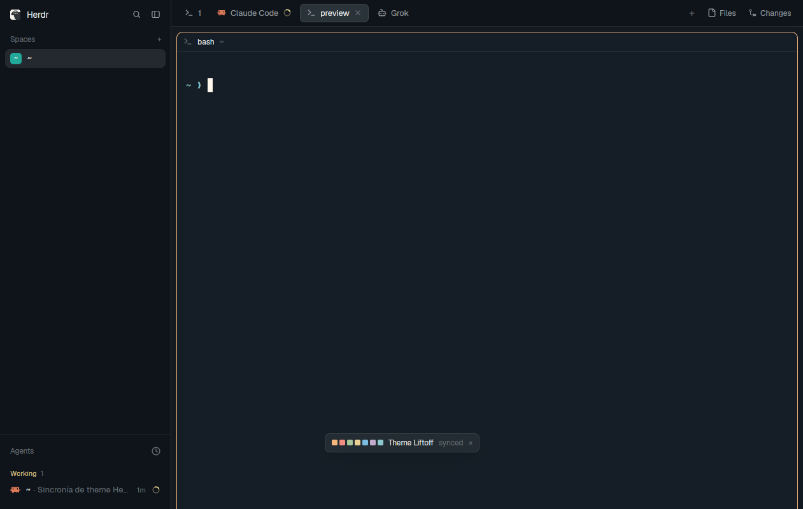

# Omarchy theme

A small floating pill that keeps Herdr dressed in your Omarchy theme. It adds
a theme called `omarchy` to Settings → Look, rewrites it from the active
Omarchy palette every time you run `omarchy theme set` (or pick a theme in
Omarchy's menu), and recolors the open window when that theme is the one in
use. The pill shows the palette, the Omarchy theme's name and whether Herdr
is following it.



## What you see

One kept window (`kind: "window"`), about 242×28 px plus Herdr's window frame
(theme background, 1 px border, rounded corners, shadow). It opens centered
the first time and stays wherever it is dragged. Left to right, 8 px apart,
10 px side padding, text 11.8 px:

1. **Swatches:** seven 9×9 px squares with 2 px corners, 3 px apart, filled
   with the Omarchy palette's `accent`, then `color1`..`color6` (red, green,
   yellow, blue, magenta, cyan). With the Liftoff theme: `#f3b77b`,
   `#ef8d80`, `#a9c59a`, `#ead093`, `#7bbce0`, `#c3abcc`, `#8bc8d0`.
2. **Theme name** in the theme's `foreground`: Omarchy's slug prettified the
   way `omarchy theme current` prints it (`theme-liftoff` → `Theme Liftoff`).
   `Omarchy` until the first read.
3. **State:** `synced` in `dim` when Herdr's terminal background equals the
   Omarchy background; otherwise a `use` button in `accent`.
4. **`×`** in `dim`.

On error (no Omarchy, or a palette color that isn't `#rrggbb`) a message in
`blocked` color, at most 220 px wide and truncated, takes the place of the
state.

## How it behaves

- The mod has nothing to do with agent status: working, blocked, done and
  idle all look the same.
- On start, and after every change under `~/.local/state/omarchy/current`,
  it reads the palette and writes `~/.config/herdr-app/themes/omarchy.json`.
  The file is only rewritten when its text changes.
- When the file changed and `omarchy` is the theme picked for the shown
  layout (plain, or in its light or dark half; else settings.json's
  `theme`), the window is recolored at once: `app.theme graphite` (or
  `paper` for a light palette) then `app.theme omarchy`. That can show as a
  brief flicker. If another theme is in use, only the file changes, and
  Herdr is left alone.
- `use` runs `app.theme omarchy`. Herdr puts it in the half of its
  lightness, so with Omarchy driving the system's light/dark mode the shown
  half is always the one just set.
- `×` closes the window. Closing it stops the syncing, and it stays closed
  across restarts until it is opened again.
- Dragging anywhere but the two buttons moves the window. Herdr remembers
  the spot and reopens it there on every start.

## Built from

- `mods/omarchy-theme/main.js` and `mod.json`:
  `{ "place": "none", "title": "Omarchy theme", "overlay": { "kind": "window", "key": "omarchy-theme", "keep": true } }`.
  No layout, no `keys.json`, no shipped mods, no art.
- Opened once with `herdr-app do mod.open --name omarchy-theme`. The
  `key` + `keep` overlay makes Herdr record it in `windows.json` under
  `kept.<layout>` and reopen it with that layout on every start.
- `herdr` functions: `exec`, `home`, `appHome`, `readTextFile`,
  `writeTextFile`, `watchFolder`, `shared("layout")`, `settings()`,
  `theme()`, `run`, `props().overlay`, `closeOverlay`.
- Commands: `app.theme {name}` with `graphite`, `paper` and `omarchy`.
- Program: `omarchy-theme-color --file ~/.local/state/omarchy/current/theme/colors.toml --all`
  (Omarchy 4+). It prints `key<TAB>value` lines and resolves older themes
  that only define `color0..15`. Keys used: `background`, `foreground`,
  `selection_background`, `cursor`, `accent`, `color0`..`color15`, `mode`.
- Files read outside its folder: that `colors.toml` (through the program),
  `~/.local/state/omarchy/current/theme.name` and
  `~/.config/herdr-app/layouts/.state/<layout>.json` (read only).
  File written: `~/.config/herdr-app/themes/omarchy.json`. No network.
- The theme file, colors lower-cased:

  ```json
  {
    "background": "<background>",
    "foreground": "<foreground>",
    "selection": "<selection_background>",
    "cursor": "<cursor>",
    "ansi": [
      "<color0>", ..., "<color7>",
      "<color8>", ..., "<color15>"
    ],
    "colors": {
      "accent": "<accent>"
    }
  }
  ```

## Watch out

- **`place: "bottom"` doesn't work here.** Herdr never docked a new mod
  into its shipped `main` layout (tried live, after a restart and with a
  minimal probe mod), and `layout.set` refuses structure changes on shipped
  layouts. A kept window works on any layout without cloning it.
- **Herdr caches theme files.** Rewriting `omarchy.json` doesn't recolor the
  window, and `app.theme omarchy` while `omarchy` is shown keeps the old
  colors. Only picking another theme first reloads it. Use a preset of the
  same lightness (`graphite` dark, `paper` light) so the round trip leaves
  the person's other half alone.
- Only bounce when `omarchy` is actually picked. Detect that from
  `layouts/.state/<layout>.json` (`theme` is a string or `{light, dark}`),
  falling back to `settings().theme`. Never write `.state` files.
- Watch `~/.local/state/omarchy/current`, not `current/theme`:
  `omarchy theme set` deletes `theme/` and moves a new folder into place. In
  between, `colors.toml` is missing and the program fails. Skip that event
  and the next one carries the new theme.
- `writeTextFile(path, text, expected)` needs the current contents as
  `expected` (`null` for a new file), or it rejects.
- Buttons inside a window must stop the press
  (`.on_mouse_down("left", (_e, cx) => cx.stop_propagation())`) or a click
  starts a drag.
- Don't keep `cx`. The watch loop runs in `cx.spawn` and calls
  `cx.notify()` with the task's own `cx`.
- `exec` runs with the person's real PATH. If `omarchy-theme-color` isn't
  there, show the error rather than writing a partial theme.
- If the person also has a shell hook writing the same file (an earlier
  version of this mod was one), remove it, or each theme change recolors
  twice.
- Assumes Omarchy 4+ and this computer. It doesn't follow spaces on other
  machines.

## Done when

- `herdr-app check ~/.config/herdr-app/mods/omarchy-theme` passes.
- After `herdr-app do mod.open --name omarchy-theme`, `herdr-app status`
  lists `omarchy-theme` in `overlays` and `windows.json` has it under
  `kept.main`.
- `~/.config/herdr-app/themes/omarchy.json` exists, parses as JSON, has 16
  `ansi` colors and its `background` equals
  `omarchy-theme-color --file ~/.local/state/omarchy/current/theme/colors.toml background`,
  lower-cased.
- `omarchy` appears in Settings → Look. With it picked,
  `OMARCHY_THEME_SKIP_BACKGROUND=1 omarchy theme set catppuccin` turns the
  window's terminals `#1e1e2e` within a few seconds (`herdr-app shot`) and
  the pill reads `Catppuccin` and `synced`.
- With another theme picked, the same change rewrites the file but leaves
  the window's colors alone, and the pill shows `use`. Clicking it switches
  Herdr to `omarchy`.
- After closing and reopening Herdr the pill is back where it was dragged.
